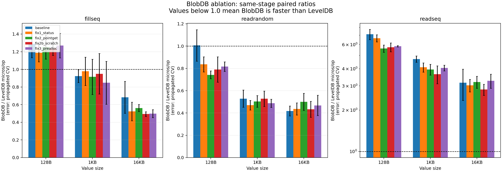
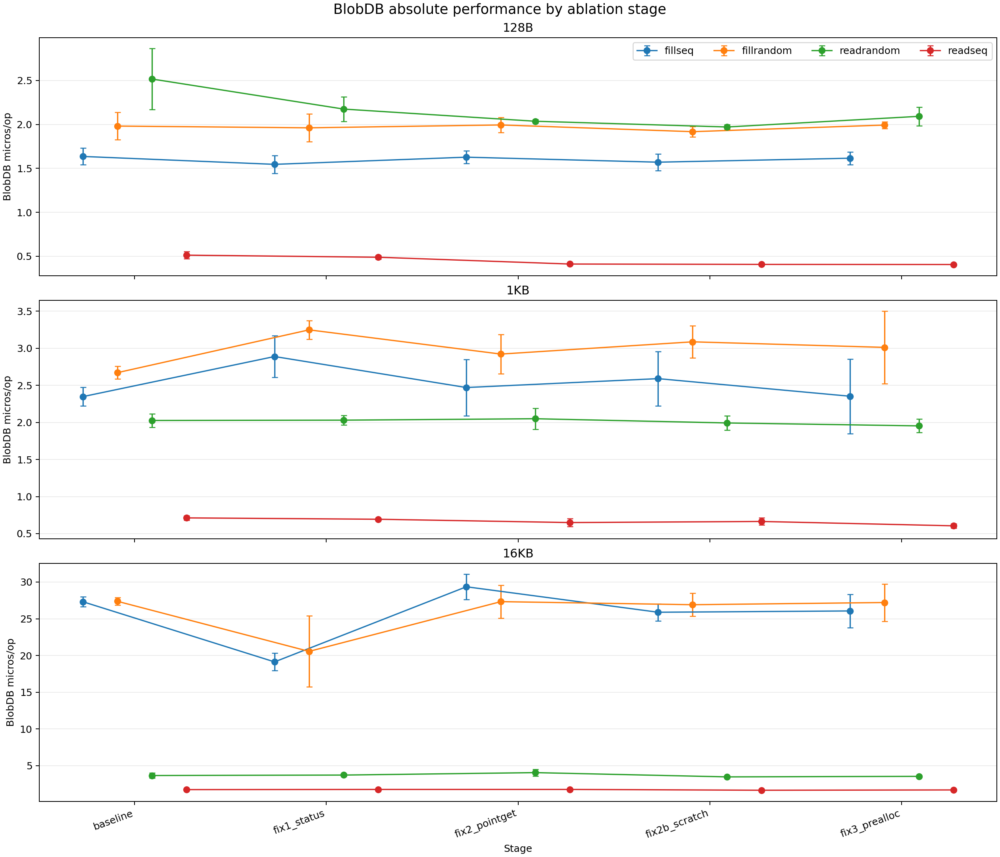
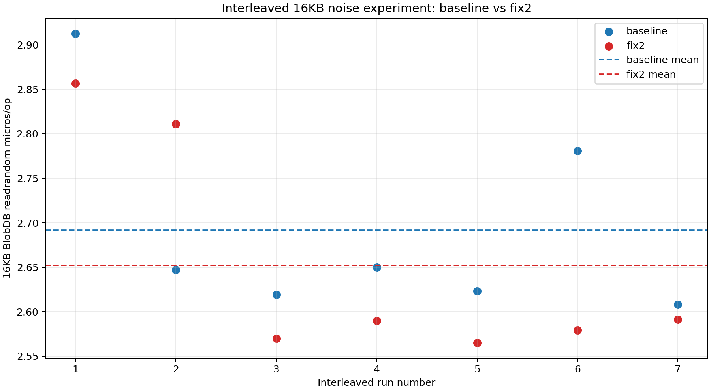

# BlobDB Performance Ablation

This document records the controlled benchmark comparison on branch `devin/blobdb-perf`. All raw benchmark rows and derived paired summaries are committed under `./data/`.

## Environment

| Item | Value |
|---|---|
| CPU | 8 logical cores; Intel Xeon Platinum 8559C reported by `db_bench` |
| Memory | 31 GiB RAM; no swap |
| Storage | `/dev/root`, 122G visible filesystem; underlying `vda`, rotational flag `ROTA=1`; model string was not exposed |
| Compiler | GCC 11.4.0 |
| Build | CMake 3.22.1, Release |
| Compression | Snappy unavailable (`db_bench` warning) |
| Cache state | Warm page cache; datasets fit in RAM; no page-cache dropping |
| Concurrency | Benchmark runs serialized; BlobDB iterator prefetch disabled and `blob_iter_threads=0` |
| GC | Not triggered by these runs; configured interval was 600 seconds |

**Limitations:** the datasets are smaller than available memory, so these results primarily measure warm page-cache behavior. The point-read and scan measurements are single-threaded. GC behavior is not covered by this benchmark set.

## Methodology

Each benchmark starts from a fresh database directory. Configurations are 128B/4,000,000 entries, 1KB/1,000,000 entries, and 16KB/100,000 entries. The common benchmark list is `fillseq,fillrandom,overwrite,readrandom,readrandom,readseq,readreverse`; the tables select `fillseq`, `fillrandom`, `readrandom#1`, and `readseq#1`. LevelDB and BlobDB are both rerun within every stage.

The primary metric is the same-stage BlobDB/LevelDB mean `micros/op` ratio. This pairs the two modes under the same machine state and reduces sensitivity to stage-to-stage drift. In the interleaved 16KB experiment, seven alternating runs produced:

| benchmark | baseline mean ± SD | fix2 mean ± SD | fix2/baseline |
|---|---:|---:|---:|
| fillrandom | 30.403 ± 0.963 | 29.836 ± 1.057 | 0.981 |
| readrandom | 2.692 ± 0.114 | 2.652 ± 0.125 | 0.985 |

The interleaved noise logs are retained with the benchmark artifacts and the experiment is plotted in `./assets/blobdb_noise_16k.png`. A 1.5% interleaved difference is much smaller than the absolute drift seen between independent stages, so absolute cross-stage values are secondary evidence.

## Fixes

### Fix 1: status propagation

- Commit: `82bb15c Propagate value log get status`
- File: `db/blob_vlog_impl.cc`
- Changed `ValueLogImpl::Get` to return the status from `GetLocked` after releasing the writable-file reference, instead of unconditionally returning `Status::OK()`.

### Fix 2: direct point gets

- Commit: `9de5713 Add direct value log point gets`
- Files: `db/blob_vlog_impl.cc`, `db/blob_vlog_impl.h`, `db/blob_vlog_cache.cc`, `db/blob_vlog_cache.h`, `table/vlog.cc`, `table/vlog.h`
- Replaced per-get vlog iterator construction and temporary handle encoding with exact offset/size reads, pinned cache handles, in-place decode, and 512B stack scratch with larger-record fallback.

### Fix 2b: reusable scratch

- Commit: `1675bc4 Reuse point get scratch buffers`
- File: `table/vlog.cc`
- Replaced the per-call larger-record heap buffer with a thread-local grow-only scratch string. Each thread may allocate when it first exceeds its current capacity; subsequent gets reuse that capacity.

### Fix 3: vlog preallocation

- Commit: `26337f0 Preallocate value log append files`
- Files: `include/leveldb/env.h`, `util/env_posix.cc`, `db/blob_vlog_impl.cc`, `db/blob_vlog_gc.cc`, `table/vlog.cc`
- Added an optional preallocation size to the appendable-file API; POSIX vlog files use `ftruncate`, `posix_fallocate`, one full-range mmap, and `MADV_SEQUENTIAL`. The sequential validation parser treats `key_len == 0` as end-of-data so an uncleanly closed preallocated zero tail is truncated during recovery.

## Validation status

The following status was unchanged across baseline, Fix 1, Fix 2, Fix 2b, and Fix 3:

- `DBTest.*`: 58/58 passed.
- `c_test`: passed.
- `env_posix_test`: passed.
- `VLOG_TEST.DBWrapperGC_FailAfterValueRewrite`: failed at baseline and continued to fail with SIGSEGV after each of the four commits. The assertion and failure behavior did not change.

Fix 3's specific recovery validation interrupted a live writer with `kill -9`. The resulting preallocated vlog had a 227MB zero tail; restart completed recovery in `0.092 sec`, and the reopened database returned `1000 of 1000000 found` for random reads. This is evidence that the zero-tail validation guard avoids an unbounded scan after an unclean shutdown.

## Paired ratio table

BlobDB/LevelDB mean `micros/op`; values below 1.0 mean BlobDB is faster. All rows use the repeat counts present in `./data/blobdb_ablation_summary.csv`.

Figure 1 adds propagated uncertainty bars. For each ratio, the relative standard deviation is estimated as `sqrt(CV_blob^2 + CV_level^2)`, so the displayed error is the ratio multiplied by that relative standard deviation.

| value | stage | fillseq | fillrandom | readrandom#1 | readseq#1 |
|---:|---|---:|---:|---:|---:|
| 128B | baseline | 1.290 | 0.605 | 1.006 | 7.125 |
| 128B | fix1_status | 1.186 | 0.493 | 0.836 | 6.673 |
| 128B | fix2_pointget | 1.251 | 0.515 | 0.742 | 5.618 |
| 128B | fix2b_scratch | 1.237 | 0.464 | 0.790 | 5.742 |
| 128B | fix3_prealloc | 1.269 | 0.482 | 0.816 | 5.837 |
| 1KB | baseline | 0.924 | 0.144 | 0.529 | 4.707 |
| 1KB | fix1_status | 0.978 | 0.141 | 0.470 | 4.098 |
| 1KB | fix2_pointget | 0.915 | 0.137 | 0.503 | 3.951 |
| 1KB | fix2b_scratch | 0.950 | 0.141 | 0.527 | 3.655 |
| 1KB | fix3_prealloc | 0.848 | 0.141 | 0.487 | 4.054 |
| 16KB | baseline | 0.683 | 0.092 | 0.418 | 3.164 |
| 16KB | fix1_status | 0.523 | 0.076 | 0.437 | 3.029 |
| 16KB | fix2_pointget | 0.562 | 0.084 | 0.500 | 3.205 |
| 16KB | fix2b_scratch | 0.493 | 0.081 | 0.433 | 2.823 |
| 16KB | fix3_prealloc | 0.499 | 0.081 | 0.468 | 3.268 |

## BlobDB absolute values

BlobDB mean `micros/op` ± sample standard deviation, with CV and repeat count. These are auxiliary because independent stages experience machine drift.

| value | stage | fillseq | fillrandom | readrandom#1 | readseq#1 |
|---:|---|---|---|---|---|
| 128B | baseline | 1.636 ± 0.095 (5.8%, n=3) | 1.982 ± 0.156 (7.9%, n=3) | 2.518 ± 0.349 (13.9%, n=3) | 0.513 ± 0.042 (8.1%, n=3) |
| 128B | fix1_status | 1.546 ± 0.102 (6.6%, n=3) | 1.962 ± 0.159 (8.1%, n=3) | 2.175 ± 0.141 (6.5%, n=3) | 0.489 ± 0.020 (4.0%, n=3) |
| 128B | fix2_pointget | 1.628 ± 0.072 (4.4%, n=3) | 1.995 ± 0.084 (4.2%, n=3) | 2.037 ± 0.021 (1.0%, n=3) | 0.412 ± 0.010 (2.3%, n=3) |
| 128B | fix2b_scratch | 1.571 ± 0.095 (6.0%, n=3) | 1.918 ± 0.057 (3.0%, n=3) | 1.971 ± 0.028 (1.4%, n=3) | 0.408 ± 0.007 (1.7%, n=3) |
| 128B | fix3_prealloc | 1.616 ± 0.072 (4.5%, n=3) | 1.993 ± 0.039 (2.0%, n=3) | 2.093 ± 0.105 (5.0%, n=3) | 0.407 ± 0.004 (0.9%, n=3) |
| 1KB | baseline | 2.348 ± 0.127 (5.4%, n=3) | 2.671 ± 0.086 (3.2%, n=3) | 2.027 ± 0.090 (4.4%, n=3) | 0.712 ± 0.029 (4.1%, n=3) |
| 1KB | fix1_status | 2.889 ± 0.282 (9.8%, n=3) | 3.249 ± 0.126 (3.9%, n=3) | 2.031 ± 0.063 (3.1%, n=3) | 0.694 ± 0.009 (1.2%, n=3) |
| 1KB | fix2_pointget | 2.471 ± 0.380 (15.4%, n=3) | 2.922 ± 0.264 (9.0%, n=3) | 2.050 ± 0.140 (6.8%, n=3) | 0.649 ± 0.053 (8.1%, n=3) |
| 1KB | fix2b_scratch | 2.591 ± 0.367 (14.1%, n=3) | 3.088 ± 0.217 (7.0%, n=3) | 1.993 ± 0.099 (4.9%, n=3) | 0.664 ± 0.048 (7.2%, n=3) |
| 1KB | fix3_prealloc | 2.354 ± 0.503 (21.4%, n=3) | 3.013 ± 0.488 (16.2%, n=3) | 1.954 ± 0.091 (4.6%, n=3) | 0.605 ± 0.028 (4.7%, n=3) |
| 16KB | baseline | 27.322 ± 0.658 (2.4%, n=3) | 27.381 ± 0.515 (1.9%, n=3) | 3.665 ± 0.354 (9.7%, n=3) | 1.746 ± 0.014 (0.8%, n=3) |
| 16KB | fix1_status | 19.131 ± 1.182 (6.2%, n=5) | 20.561 ± 4.823 (23.5%, n=5) | 3.728 ± 0.201 (5.4%, n=5) | 1.773 ± 0.037 (2.1%, n=5) |
| 16KB | fix2_pointget | 29.354 ± 1.726 (5.9%, n=5) | 27.330 ± 2.252 (8.2%, n=5) | 4.059 ± 0.458 (11.3%, n=5) | 1.773 ± 0.101 (5.7%, n=5) |
| 16KB | fix2b_scratch | 25.887 ± 1.163 (4.5%, n=5) | 26.912 ± 1.563 (5.8%, n=5) | 3.480 ± 0.124 (3.6%, n=5) | 1.664 ± 0.036 (2.2%, n=5) |
| 16KB | fix3_prealloc | 26.064 ± 2.270 (8.7%, n=5) | 27.212 ± 2.538 (9.3%, n=5) | 3.553 ± 0.103 (2.9%, n=5) | 1.704 ± 0.116 (6.8%, n=5) |

## Figures

### Paired ratios

### BlobDB absolute micros/op

### Interleaved noise

## What the data does and does not support

### Supported by the data

- Fix 2 and Fix 2b support a real reduction in point-get and scan fixed overhead. For 128B, `readrandom#1` moved from a baseline paired ratio of `1.006` to `0.742` in Fix 2, then remained `0.790` in Fix 2b and `0.816` in Fix 3. The BlobDB absolute mean moved from `2.518 us/op` to approximately `2.0 us/op`. Its BlobDB CV tightened from `13.9%` at baseline to `1.0–5.0%` in the later stages. The cross-stage consistency and variance reduction are stronger evidence than any one stage-to-stage difference.
- The same pattern is present for 128B `readseq#1`: the paired ratio moved from `7.125` to `5.618–5.837`, the absolute BlobDB mean moved from `0.513` to approximately `0.407 us/op`, and the later-stage BlobDB CV was at or below approximately `2.3%` (with Fix 3 at `0.9%`). This supports reduced per-value fixed overhead, while the scan path remains much slower than LevelDB.
- Fix 1 is justified by correctness: it propagates the status already returned by `GetLocked`. It is not a performance optimization and is not on the hot path in a way that supports attributing the apparent benchmark changes to Fix 1.
- Fix 3 is justified by removing a structural risk and cost: repeated `ftruncate`/remap growth and delayed extent allocation in the append path, plus the unclean-shutdown zero-tail recovery hazard. Its kill-9 recovery evidence is documented above.

### Not supported, or within noise

- The stage-to-stage differences in `fillseq` and `fillrandom` are not attributable to a specific fix from this data. Their per-stage CVs reach approximately `8–21%`, and the interleaved 16KB experiment shows machine drift larger than the observed Fix 2 readrandom effect in absolute units.
- In particular, the apparent Fix 1 improvements in the table—128B `readrandom#1` changing from `1.006` to `0.836`, and 16KB `fillseq` changing from `0.683` to `0.523`—must not be attributed to Fix 1. They are machine drift, not evidence of a Fix 1 performance effect.
- The 1KB `fillseq` change from `0.924` to `0.848` in Fix 3 is not a performance conclusion. Fix 3's performance effect is not separable from the current noise level using these independent stages.
- GC cost is not represented in this benchmark set because the 600-second GC interval was not reached and no GC workload was forced.

### Future work

1. Reduce the remaining 128B `fillseq` overhead, including the extra write-path traversals/copies and independent vlog/LSM queueing.
2. Investigate batched or offset-ordered scan reads instead of one random vlog read/task per value.
3. Add a dedicated GC benchmark and measure rewrite, discard accounting, foreground interference, and recovery costs.

## Reproducibility

- Raw parsed rows: [`./data/blobdb_ablation_raw.csv`](./data/blobdb_ablation_raw.csv)
- Paired summary: [`./data/blobdb_ablation_summary.csv`](./data/blobdb_ablation_summary.csv)
- The benchmark driver and original logs remain outside the repository and are not part of this commit.
